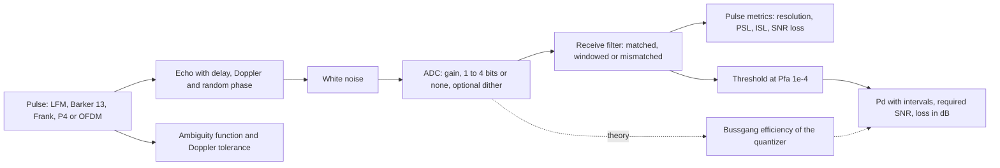
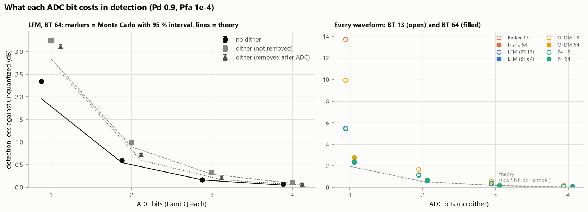
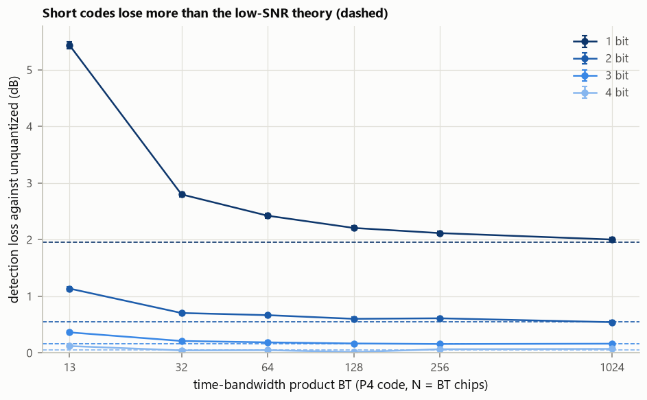
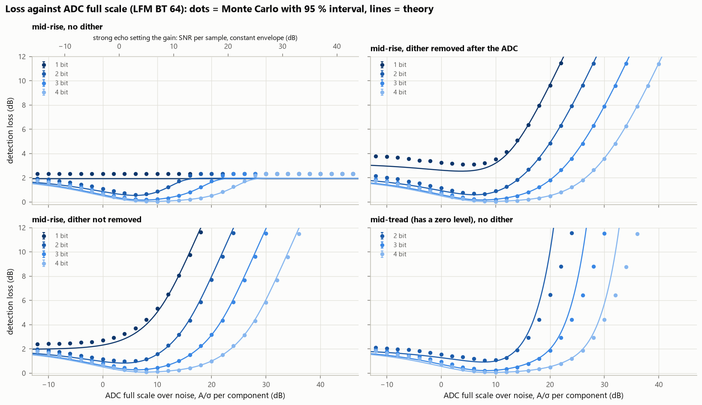
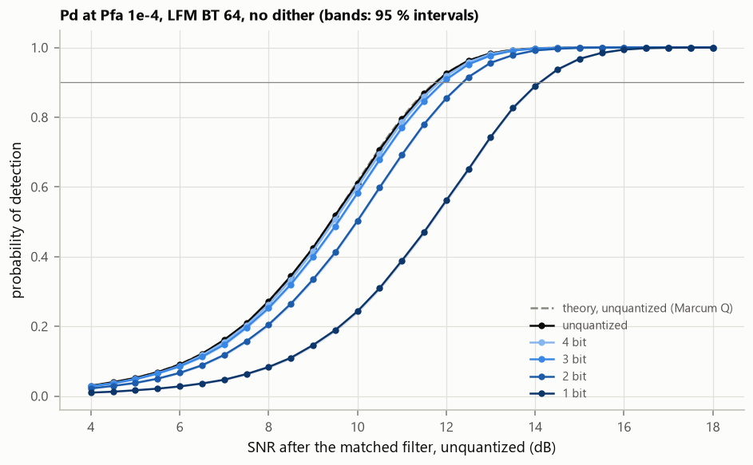
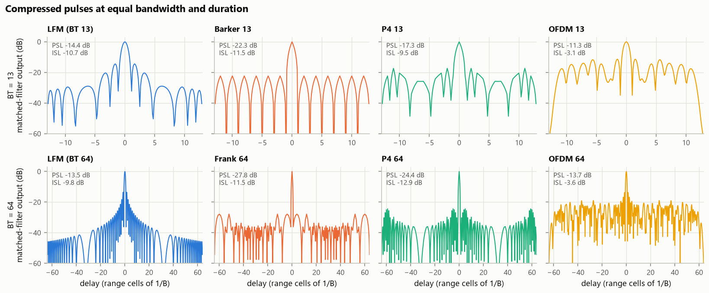
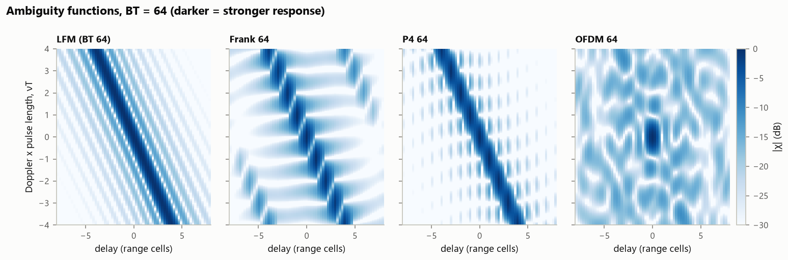
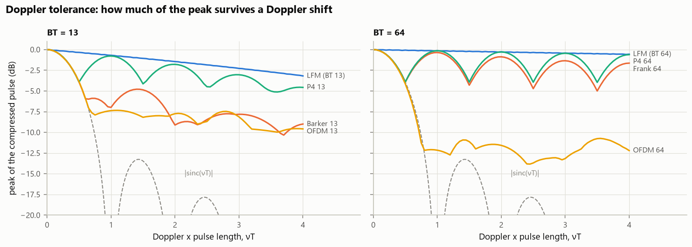
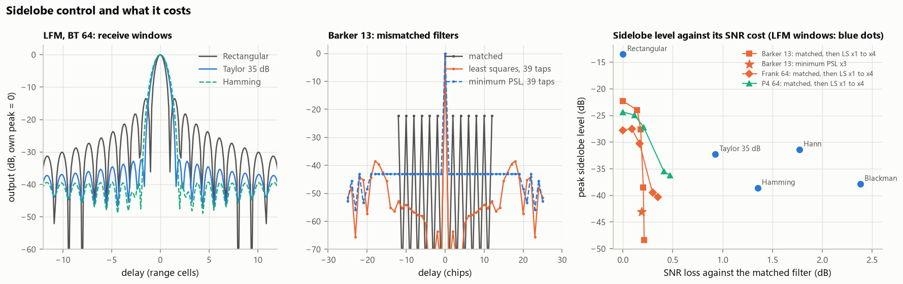

# Radar Waveform Design and Matched Filtering: LFM, Phase-Coded and OFDM Pulses with Low-Bit ADC Analysis

**How much detection a pulse radar gives up when its ADC keeps only 1 to 4 bits per sample, measured by Monte Carlo simulation and checked against theory: 0.17 dB at 3 bits and 2.34 dB at 1 bit for a 64-chip pulse (theory 0.17 and 1.96 dB), with five pulse waveforms compared at equal bandwidth and duration.**


[](https://github.com/Adan-Khalid/radar-waveform-design/actions/workflows/ci.yml)

<p align="center">
  
</p>
<p align="center"><em>Left: what each ADC bit costs when noise sets the gain, measured against the theory (P4 code at three lengths). Right: when a strong echo elsewhere sets the gain (horizontal axis: its SNR per sample, about 3 dB below the full scale over the noise used in the tables), a plain ADC never loses more than its 1-bit value, while dither and mid-tread ADCs keep losing (<code>scripts/make_readme_assets.py</code>).</em></p>

## In plain words

A pulse radar sends a coded pulse and finds the echo by correlating what comes back with a copy of the pulse (the matched filter). Before that, an analog-to-digital converter (ADC) turns the received signal into numbers. Fewer bits per sample make the receiver cheaper, faster and less power-hungry, which matters when a radar has many receive channels: car and drone radars, and 6G base stations that also sense. I simulated the whole receiver and measured how much stronger an echo must be to be detected with 1, 2, 3 and 4-bit ADCs, with and without dither, and checked every number against theory. I also compared five pulse shapes at the same bandwidth and duration: how sharp their peaks are, how high their sidelobes are, how they cope with a moving target, and what lowering their sidelobes costs.

## Results at a glance

Probability of detection 0.9 at a false-alarm rate of 10⁻⁴, a non-moving point target with random phase, one complex sample per range cell. Loss = extra signal-to-noise ratio (SNR) a receiver needs against an unquantized one tested on the same simulated trials. Brackets: 95 % intervals.

| What is measured | Baseline | This project | Source |
| --- | --- | --- | --- |
| SNR needed with no quantization (64-chip LFM) | 11.75 dB from theory (Marcum Q) | **11.75 dB** [11.72, 11.79] measured | `reports/summary/headline.csv` |
| Loss of a 3-bit ADC (64-chip LFM) | 0.17 dB from theory | **0.17 dB** [0.15, 0.19] | same |
| Loss of a 1-bit ADC (64-chip LFM) | 1.96 dB from theory | **2.34 dB** [2.30, 2.38]; with a P4 code: 2.00 dB [1.97, 2.04] at 1024 chips, 5.43 dB at 13 chips | same |
| Weak target when a strong echo sets the gain, ADC full scale 30 dB above the noise, 3 bits | plain mid-rise ADC: **2.34 dB** | dither removed after the ADC: 7.90 dB; mid-tread ADC: 11.52 dB | same |
| Barker 13 peak sidelobe | −22.3 dB (matched filter) | **−38.5 dB** with a 39-tap least-squares filter, for 0.20 dB of SNR | same |

## The problem

Radar designers want fewer ADC bits: a 77 GHz car radar or a joint sensing and communication base station digitises many channels at high rates, and every bit costs power and data rate. The textbook answer is that one bit costs about 2 dB (the factor 2/π), and three bits almost nothing. That answer assumes weak echoes in white noise, an ADC gain set for the noise, and long codes. This project measures where it holds and where it breaks: short codes, binary codes, dither, an ADC gain set by a strong echo, and an OFDM pulse with a high peak-to-average power ratio. The same code base also covers the waveform side (sidelobes, Doppler tolerance, sidelobe control and its SNR cost), because the pulse decides how a quantized receiver behaves.

## Approach



- **Waveforms** are compared at the same bandwidth B and duration T: 13 chips (LFM, Barker 13, P4, OFDM with 13 subcarriers) and 64 chips (LFM, Frank, P4, OFDM with 64 subcarriers), all at unit energy.
- **Pulse metrics and the ambiguity function** are written from their definitions and tested against closed forms: Barker 13's −22.28 dB sidelobes, the sinc limits of LFM, the sampled sinc of the zero-delay cut and the exact volume identity of the ambiguity function.
- **Sidelobe control:** amplitude windows on the LFM reference (Taylor written out from its formula) and least-squares mismatched filters on phase codes, plus a minimum-peak-sidelobe filter for Barker 13 by linear programming. Each comes with its SNR cost.
- **ADC model:** I and Q each pass a uniform quantizer (mid-rise or mid-tread), with optional dither of one step that is either left in or removed after the ADC.
- **Theory:** the Bussgang efficiency η = E[x q(x)]² / (σ² E[q(x)²]) of each quantizer, computed exactly for every bit depth, gain and dither setting, predicts the loss at low SNR per sample.
- **Measurement:** the Monte Carlo detector sets each receiver's threshold from 2 × 10⁶ noise-only statistics (randomised on ties, so Pfa is exact even when one-bit statistics take only a few values) and checks it on fresh noise. It finds the SNR for Pd 0.9 on a 0.1 dB grid with 20,000 trials per point. Every receiver sees the same noise, phases and dither, so differences between receivers are measured with a paired bootstrap.

The maths, design choices and rejected alternatives for every part are in [`docs/LEARNING.md`](docs/LEARNING.md).

## Results

### What each bit costs

<p align="center">
  
</p>
<p align="center"><em>When noise sets the ADC gain, dither does not help: it only adds noise. At 64 chips every constant-envelope pulse loses about the same; at 13 chips everything loses more.</em></p>

Loss in dB against the unquantized receiver, no dither, ADC step set to the best value for the noise (`reports/adc/a1_losses.csv`):

| Receiver | LFM 64 | Frank 64 | P4 64 | OFDM 64 | LFM 13 | Barker 13 | P4 13 | OFDM 13 | Theory |
| --- | --- | --- | --- | --- | --- | --- | --- | --- | --- |
| 4 bit | 0.07 | 0.07 | 0.05 | 0.05 | 0.16 | 0.13 | 0.12 | 0.20 | 0.05 |
| 3 bit | 0.17 | 0.20 | 0.19 | 0.18 | 0.40 | 0.38 | 0.36 | 0.59 | 0.17 |
| 2 bit | 0.60 | 0.66 | 0.67 | 0.72 | 1.20 | 1.17 | 1.14 | 1.67 | 0.55 |
| 1 bit | 2.34 | 2.38 | 2.42 | 2.78 | 5.52 | 13.78 | 5.43 | 9.97 | 1.96 |

At one sample per range cell the sampled LFM is the P4 code times a linear phase ramp, so the LFM and P4 columns are the same waveform measured on different random trials; their difference shows the run-to-run spread.

With dither, 64-chip LFM: 3 bits lose 0.33 dB with the dither left in and 0.21 dB with it removed (no dither: 0.17 dB); 1 bit loses 3.24 and 3.11 dB (no dither: 2.34 dB).

Two results go beyond the textbook figure:
- **Barker 13 at 1 bit loses 13.8 dB.** I and Q are quantized separately, and a binary code arriving at phase 0 puts its whole echo into I. The I sum then saturates at 13, and the statistic only crosses the threshold when the noise signs in Q happen to line up: at Pfa 10⁻⁴, Pd stays at 0.09 even at 40 dB, while the same echo at 45° is found with Pd 0.95 at 16 dB (`reports/adc/phase_pd_curves.csv`). P4, a complex code, is found at every phase. The study assumes no Doppler, so the echo phase is constant over the pulse.
- **One bit with the dither removed never reaches Pd 0.9 with a 13-chip code**: even at 60 dB, Pd stays at 0.85 (LFM), 0.86 (P4) and 0.66 (OFDM), because the one-bit echo has a fixed size however strong it is, so with only 13 samples the statistic saturates a few dB above the threshold, while the removed dither leaves a noise term that does not shrink (`reports/adc/a1_pd_curves.csv`).

### Short codes lose more than the theory

<p align="center">
  
</p>
<p align="center"><em>The 2/π rule needs the SNR of each sample to be small, which only holds for long codes (P4 code, <code>reports/adc/a3_losses.csv</code>).</em></p>

| Bits | 13 chips | 32 | 64 | 128 | 256 | 1024 | Theory |
| --- | --- | --- | --- | --- | --- | --- | --- |
| 1 | 5.43 | 2.80 | 2.42 | 2.21 | 2.12 | 2.00 | 1.96 |
| 2 | 1.14 | 0.71 | 0.67 | 0.60 | 0.61 | 0.54 | 0.55 |
| 3 | 0.36 | 0.21 | 0.19 | 0.17 | 0.16 | 0.16 | 0.17 |
| 4 | 0.12 | 0.05 | 0.05 | 0.02 | 0.07 | 0.07 | 0.05 |

### When a strong echo sets the ADC gain

<p align="center">
  
</p>
<p align="center"><em>LFM, 64 chips. Each extra bit moves the rise by 6 dB. Dots are measured, lines are theory; the theory overestimates the mid-tread loss at large full scale, where the echo needed for detection is no longer weak per sample.</em></p>

Here "full scale above the noise" is 20 log10(A/σ), with A the ADC's clipping level and σ the noise standard deviation of I or Q; the best value for noise alone is about 4 to 9 dB. If a strong echo elsewhere in the receive window sets the ADC gain, the step becomes large compared with the noise around a weak target. A plain mid-rise ADC then acts as a one-bit receiver and loses at most its one-bit value, here 2.34 dB. Dither adds power in proportion to the step squared, and a mid-tread ADC sends weak samples to zero, so both keep losing (`reports/adc/a2_losses.csv`):

| Full scale above the noise | 6 dB | 12 dB | 18 dB | 24 dB | 30 dB |
| --- | --- | --- | --- | --- | --- |
| 3 bit, mid-rise, no dither | 0.25 | 0.31 | 1.24 | 2.34 | 2.34 |
| 3 bit, mid-rise, dither removed | 0.26 | 0.32 | 1.25 | 3.59 | 7.90 |
| 3 bit, mid-rise, dither left in | 0.35 | 0.67 | 2.25 | 5.86 | 11.54 |
| 3 bit, mid-tread, no dither | 0.38 | 0.36 | 1.20 | 4.41 | 11.52 |

An OFDM pulse pays for its peak-to-average power ratio here: with the gain set so the strong echo's peaks just fit, the 64-subcarrier pulse (7.3 dB PAPR) needs 7.3 dB more full scale than a constant-envelope pulse of the same power. Next to a strong echo 10 dB above the noise per sample, a 3-bit receiver loses 1.80 dB on a weak target if that strong echo is OFDM and 0.42 dB if it has a constant envelope (`reports/adc/a2_strong_echo.csv`). These two numbers read the LFM full-scale curve at the full scale each strong echo needs, using the complex-sample PAPR (an upper bound on the peak of I or Q); an all-OFDM radar would also lose a little more on the weak target itself (2.78 against 2.34 dB at 1 bit in the bit-depth table).

### Detection curves against theory

<p align="center">
  
</p>
<p align="center"><em>The unquantized Monte Carlo curve agrees with the Marcum Q prediction at all 29 points (inside every 95 % interval; <code>reports/adc/pd_pd_curves.csv</code>).</em></p>

### Waveforms at equal bandwidth and duration

<p align="center">
  
</p>
<p align="center"><em>Compressed pulses (<code>reports/waveforms/metrics.csv</code>). The phase codes give the lowest sidelobes and the narrowest peaks, partly because rectangular chips spread energy beyond the nominal bandwidth B that all pulses share; OFDM with random data symbols gives a noise-like sidelobe floor.</em></p>

| Waveform | PSL (dB) | ISL (dB) | −3 dB width (cells) | Width at B = 1 MHz (m) | PAPR of the samples (dB) |
| --- | --- | --- | --- | --- | --- |
| LFM, BT 13 | −14.4 | −10.7 | 0.87 | 130 | 0.0 |
| Barker 13 | −22.3 | −11.5 | 0.58 | 88 | 0.0 |
| P4 13 | −17.3 | −9.5 | 0.63 | 95 | 0.0 |
| OFDM 13 | −11.3 | −3.1 | 0.88 | 132 | 3.8 |
| LFM, BT 64 | −13.5 | −9.8 | 0.88 | 131 | 0.0 |
| Frank 64 | −27.8 | −11.5 | 0.58 | 87 | 0.0 |
| P4 64 | −24.4 | −12.9 | 0.59 | 89 | 0.0 |
| OFDM 64 | −13.7 | −3.6 | 0.88 | 131 | 7.3 |

The OFDM values are for one fixed set of random QPSK symbols; over 200 draws the median PSL is −12.6 dB (13 subcarriers) and −13.6 dB (64), and the median PAPR of the samples 5.0 and 6.8 dB (`reports/waveforms/ofdm_spread.csv`). The matched filter's noise output was checked by simulation: the SNR gain comes out within 0.08 dB of 10 log10(BT) for all eight pulses, as it must for unit-energy pulses (`reports/waveforms/snr_gain.csv`).

<p align="center">
  
</p>
<p align="center"><em>Ambiguity functions, 64 chips: the diagonal ridge of LFM and P4 means a Doppler shift moves the peak in range instead of destroying it; OFDM behaves like noise, with one sharp peak.</em></p>

<p align="center">
  
</p>
<p align="center"><em>Doppler tolerance (<code>reports/ambiguity/doppler_tolerance.csv</code>).</em></p>

| Waveform | Peak first 3 dB down at νT | Peak at νT = 1 (dB, 0 = no loss) | Peak at νT = 4 (dB) | Peak moves at νT = 1 (cells) |
| --- | --- | --- | --- | --- |
| LFM, BT 64 | 18.66 | −0.14 | −0.56 | −1 |
| P4 64 | 0.44 | −0.14 | −0.62 | −1 |
| Frank 64 | 0.44 | −0.36 | −1.64 | −1 |
| OFDM 64 | 0.43 | −12.15 | −12.20 | not defined (no clear peak) |
| Barker 13 | 0.44 | −6.99 | −8.99 | not defined (no clear peak) |

νT is the Doppler shift times the pulse length: for a 64 µs pulse at 10 GHz, νT = 1 is a radial speed of 234 m/s. For every code the peak first drops 3 dB near νT = 0.44: up to about νT = 0.5 no other delay matches better, so the peak follows the zero-delay cut, which for a constant-envelope pulse is |sinc(νT)|. P4 and Frank then recover at whole numbers of νT, one range cell further on, as LFM does; Barker 13 and OFDM do not.

### Lowering sidelobes and what it costs

<p align="center">
  
</p>
<p align="center"><em>Mismatched filters buy much lower sidelobes for much less SNR than windows, but only at zero Doppler (<code>reports/sidelobes/</code>).</em></p>

| Option | PSL (dB) | ISL (dB) | SNR loss (dB) |
| --- | --- | --- | --- |
| LFM 64, no window | −13.5 | −9.8 | 0.00 |
| LFM 64, Taylor (35 dB, n̄ = 5) | −32.3 | −21.5 | 0.93 |
| LFM 64, Hamming | −38.6 | −22.9 | 1.35 |
| LFM 64, Hann | −31.4 | −23.0 | 1.77 |
| LFM 64, Blackman | −37.9 | −24.0 | 2.38 |
| Barker 13, matched filter | −22.3 | −11.5 | 0.00 |
| Barker 13, least squares, 39 taps | −38.5 | −30.0 | 0.20 |
| Barker 13, minimum PSL, 39 taps | −43.1 | −37.7 | 0.19 |
| Frank 64, least squares, 192 taps | −39.5 | −22.4 | 0.30 |
| P4 64, least squares, 192 taps | −35.5 | −20.3 | 0.41 |

LFM rows use 8 samples per range cell; the phase-code filters are designed and scored at one sample per chip, as in the literature, so their matched-filter ISL differs slightly from the waveform table above (Barker 13 is the same either way). The window losses equal the closed form (mean w)² / mean(w²) in every case. Under Doppler the least-squares filters lose their advantage: for Barker 13 the peak sidelobe rises from −38.5 dB at νT = 0 to −32.7 dB at νT = 0.05, and is no better than the matched filter's from νT = 0.18 (`reports/sidelobes/mismatched_doppler.csv`, figure `reports/figures/mismatched_doppler.png`).

### How the numbers were measured

Settings live in `configs/` (`waveforms.yaml`, `sidelobes.yaml`, `adc.yaml`); every run is seeded (2026) and logged in [`docs/EXPERIMENTS.md`](docs/EXPERIMENTS.md), with design decisions in [`docs/DECISIONS.md`](docs/DECISIONS.md). The bootstrap intervals cover the trial-to-trial noise but not the error of each threshold. A full rerun of the bit-depth study with new random numbers moved the losses by up to 0.08 dB, so treat differences under about 0.1 dB as not resolved (`reports/adc/a1_replicate_check.csv`).

### Which script makes which result

| Result | Script | Output | Time on a laptop CPU |
| --- | --- | --- | --- |
| Theory tables (required SNR, window and quantizer losses) | `scripts/run_theory.py` | `reports/theory/` | about 10 seconds |
| Waveform metrics, OFDM spread, SNR gain | `scripts/run_waveforms.py` | `reports/waveforms/` | seconds |
| Doppler tolerance | `scripts/run_ambiguity.py` | `reports/ambiguity/` | seconds |
| Windows and mismatched filters | `scripts/run_sidelobes.py` | `reports/sidelobes/` | seconds |
| Bits and dither, every waveform | `scripts/run_adc.py --study a1` | `reports/adc/a1_*.csv` | about 5 minutes |
| Replicate with new random numbers | `scripts/run_adc.py --study a1rep` | `reports/adc/a1rep_*.csv` | about 1 minute |
| ADC full scale | `scripts/run_adc.py --study a2` | `reports/adc/a2_*.csv` | about 50 minutes |
| Code length | `scripts/run_adc.py --study a3` | `reports/adc/a3_*.csv` | about 6 minutes |
| Detection curves, echo phase | `scripts/run_adc.py --study pd`, `--study phase` | `reports/adc/pd_*.csv`, `phase_*.csv` | seconds |
| Strong-echo table, replicate check | `scripts/summarise_adc.py` | `reports/adc/a2_strong_echo.csv`, `a1_replicate_check.csv` | seconds |
| Figures; hero and social preview | `scripts/make_figures.py`; `scripts/make_readme_assets.py` | `reports/figures/`; `assets/`, `reports/summary/` | about 10 seconds |

## Quickstart

```bash
git clone https://github.com/Adan-Khalid/radar-waveform-design.git
cd radar-waveform-design
uv sync --group dev
uv run pytest
uv run python scripts/run_theory.py
uv run python scripts/run_waveforms.py
uv run python scripts/run_ambiguity.py
uv run python scripts/run_sidelobes.py
uv run python scripts/run_adc.py --study a1      # about 5 minutes on a laptop CPU
uv run python scripts/make_figures.py
```

The other ADC studies are `--study a3` (code length, about 6 minutes), `--study pd` (detection curves), `--study a1rep` (replicate) and `--study a2` (ADC full scale, about 50 minutes). `scripts/summarise_adc.py` and `scripts/make_readme_assets.py` rebuild the derived tables and the images above. Every script writes to `reports/`; with the same seeds and the same library versions (`uv.lock`) the files come out the same.

The package can be used on its own:

```python
from radarwave import waveforms, matched, metrics, theory

s = waveforms.phase_code(waveforms.barker_phases(13))
y, lag = matched.autocorrelation(s)
print(metrics.psl_db(y))                       # -22.28
print(theory.quantizer_loss_db(1, 1.0))        # 1.96 dB for one bit
```

**MATLAB:** `matlab/+radarwave` holds the same functions in MATLAB (base MATLAB with the Signal Processing, Statistics and Optimization toolboxes, all in the free MATLAB Online licence), with unit tests, studies and a script that compares its results with the Python ones. These have not been run yet (see Limitations). See [`matlab/README.md`](matlab/README.md).

## Data

No external data: every signal is simulated from the settings in `configs/` with fixed seeds. What the simulation assumes is listed in [`docs/DATA_CARD.md`](docs/DATA_CARD.md).

## Limitations and next steps

- **Simulation only:** an ideal ADC apart from quantization and clipping (no jitter, offset or nonlinearity), white Gaussian noise, non-moving point targets with constant amplitude (no Swerling fluctuation), one complex sample per range cell, and a detector that knows the target's cell. Real receivers add phase noise, I/Q imbalance, clutter, CFAR loss and straddle loss.
- The threshold is randomised on ties (a standard device for comparing receivers at exactly the same false-alarm rate); a real detector would not do this. The false-alarm checks use overlapping noise windows, so their intervals are somewhat too narrow.
- Pulses share a nominal bandwidth; rectangular-chip codes spread energy beyond it, which flatters their range resolution a little.
- **The strong-echo results assume the strong echo does not overlap the weak target's samples**; it only sets the gain. When the two overlap, the quantization error becomes a fixed function of the strong echo (spurs), which is where dither is expected to help. That case is the next study.
- The OFDM pulse uses random QPSK symbols and no cyclic prefix, processed with the same matched filter as the other pulses; OFDM radar processing with a reciprocal filter is not covered.
- The MATLAB version and its comparison script are written but have not been run yet, so nothing above has been checked in MATLAB; every number comes from the Python code.
- Losses are quoted to two decimals, but a rerun with new random numbers can move them by up to about 0.08 dB (see above).
- **Next:** overlapping strong and weak echoes with and without dither; oversampled low-bit receivers; one-bit receivers with time-varying thresholds; the same receiver in fixed-point arithmetic.

## Tool experience summary

- Python, NumPy: waveforms, FFT correlation, ambiguity function, quantizer and a vectorised Monte Carlo detector ([`src/radarwave/`](src/radarwave/))
- SciPy: Marcum Q and required SNR ([`theory.py`](src/radarwave/theory.py)), minimum-peak-sidelobe filter by linear programming with HiGHS ([`sidelobes.py`](src/radarwave/sidelobes.py)), Taylor window checked against SciPy's ([`test_theory_ambiguity_sidelobes.py`](tests/test_theory_ambiguity_sidelobes.py))
- Statistics: Wilson intervals, paired Poisson bootstrap, randomised Neyman-Pearson threshold ([`detection.py`](src/radarwave/detection.py), [`test_adc_detection.py`](tests/test_adc_detection.py))
- Matplotlib: every figure, from the CSV files in `reports/` ([`make_figures.py`](scripts/make_figures.py))
- uv, ruff, pytest, GitHub Actions: locked environment, lint and format check, 62 tests on CPU ([`ci.yml`](.github/workflows/ci.yml))

## Repository layout

```
configs/   waveform, sidelobe and ADC study settings
data/      nothing to download (everything is simulated)
docs/      plan, research log, data card, decisions, experiments, learning notes
matlab/    the same package in MATLAB, with tests, studies and a cross-check
scripts/   studies, figures and README assets
src/       the radarwave package
tests/     unit tests against closed-form theory, and small Monte Carlo runs
reports/   generated tables and figures
assets/    style file, hero image, social preview
```

## References

- N. Levanon and E. Mozeson, *Radar Signals*, Wiley-IEEE Press, 2004 (waveforms, ambiguity function, Barker, Frank and P4 codes).
- M. A. Richards, *Fundamentals of Radar Signal Processing*, 2nd ed., McGraw-Hill, 2014 (matched filter, windows, quantization, detection).
- M. H. Ackroyd and F. Ghani, "Optimum mismatched filters for sidelobe suppression", IEEE Trans. Aerospace and Electronic Systems, 9(2), 214-218, 1973.
- J. M. Baden and M. N. Cohen, "Optimal peak sidelobe filters for biphase pulse compression", IEEE International Radar Conference, 249-252, 1990.
- J. Max, "Quantizing for minimum distortion", IRE Trans. Information Theory, 6(1), 7-12, 1960.
- J. J. Bussgang, "Crosscorrelation functions of amplitude-distorted Gaussian signals", MIT RLE Technical Report 216, 1952.
- R. M. Gray and T. G. Stockham, "Dithered quantizers", IEEE Trans. Information Theory, 39(3), 805-812, 1993.
- C. Sturm and W. Wiesbeck, "Waveform design and signal processing aspects for fusion of wireless communications and radar sensing", Proc. IEEE, 99(7), 1236-1259, 2011.
- Closest published work on low-bit ADC radar receivers: M. A. Shaikh, G. Joseph, A. Pandharipande and N. J. Myers, "Situation-aware dithering for dynamic range enhancement of a mixed-resolution ADC in automotive radar receivers", IEEE Trans. Radar Systems, 3, 1474-1488, 2025; A. Ameri, A. Bose, J. Li and M. Soltanalian, "One-bit radar processing with time-varying sampling thresholds", IEEE Trans. Signal Processing, 67(20), 5297-5308, 2019.

The full list, with DOIs and what each source was used for, is in [`docs/RESEARCH_LOG.md`](docs/RESEARCH_LOG.md).

## Citation

If this helps your work, please cite the repository (see `CITATION.cff`):

```bibtex
@software{khalid_radar_waveform_design,
  author = {Khalid, Adan},
  title  = {Radar Waveform Design and Matched Filtering: LFM, Phase-Coded and OFDM Pulses with Low-Bit ADC Analysis},
  url    = {https://github.com/Adan-Khalid/radar-waveform-design},
  year   = {2026}
}
```

## Licence

MIT.

**Author:** Adan Khalid
