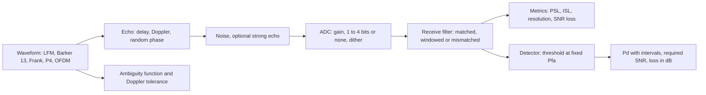

# Project plan

Radar Waveform Design and Matched Filtering: LFM, Phase-Coded and OFDM Pulses with Low-Bit ADC Analysis

## The question in plain words

A pulse radar sends a coded pulse and correlates the echo with a copy of it (the matched filter). The code decides how finely the radar separates two objects, how much a weak object hides under a strong one's sidelobes, and how badly a moving object's Doppler shift spoils the result. Then the echo has to pass through an analog-to-digital converter (ADC). Cheaper, faster, lower-power receivers use fewer ADC bits, down to one bit (only the sign of each sample). This project measures what each waveform and each bit costs, in decibels of signal-to-noise ratio, and checks every measurement against theory.

Who cares: designers of automotive, drone and 6G sensing radios, where many receive channels make ADC power and data rate the bottleneck; and anyone choosing a pulse code.

## End picture

A visitor sees in one minute:

- One picture: detection loss against ADC bits (1, 2, 3, 4 and unquantized), measured by Monte Carlo with 95 % intervals, on top of the theoretical prediction, with and without dither.
- Results at a glance: the loss of a 1-bit and a 3-bit receiver against an unquantized one; the sidelobe level and the SNR cost of each sidelobe fix; which waveform keeps its peak under Doppler.
- A Python package (`radarwave`) and a MATLAB package (`+radarwave`) that give the same numbers, with tests that check each against closed-form theory.
- Figures: matched-filter outputs, ambiguity functions, Doppler tolerance, window and mismatched-filter trade-offs, Pd curves.

## Non-goals

- No hardware: every signal is simulated. Results describe an ideal receiver with white Gaussian noise, a point target and an ideal ADC (no jitter, no nonlinearity apart from quantization and clipping).
- No multi-pulse (Doppler) processing, no CFAR and no clutter models: those are separate topics for future work.
- No claim that a method is new. Open questions are written as candidate research questions in `RESEARCH_LOG.md`.

## Pipeline

## Waveforms and the fair comparison

All waveforms in one comparison share the same bandwidth B and duration T, so the same time-bandwidth product BT, and are scaled to unit energy.

| Design point | BT | Waveforms |
| --- | --- | --- |
| short | 13 | LFM, Barker 13, P4 (13 chips), OFDM (13 subcarriers) |
| long | 64 | LFM, Frank (8 x 8 = 64 chips), P4 (64 chips), OFDM (64 subcarriers) |

- LFM: s(t) = exp(jπ(B/T)(t − T/2)²), 0 ≤ t < T, sweeping −B/2 to +B/2.
- Phase codes: N chips of length T/N, so B = N/T. Barker 13; Frank φ(i, k) = 2π i k / M for N = M²; P4 φ_n = π n²/N − π n.
- OFDM: N subcarriers spaced 1/T, centred on zero, random QPSK symbols from a fixed seed (a communication payload), no cyclic prefix. Because its sidelobes depend on the symbols, its metrics are also reported over 200 symbol draws.
- Sampling: 8 samples per 1/B for waveform metrics and ambiguity functions; 1 complex sample per 1/B for the ADC study, so each sample is one range cell and the noise is white.
- Example radar for physical units on plots: carrier 10 GHz, B = 1 MHz (150 m range resolution), so T = 13 us and 64 us.

## What gets measured

### Pulse compression (matched filter)

| Metric | Definition | Theory check |
| --- | --- | --- |
| Range resolution | −3 dB mainlobe width, in units of 1/B and in metres (c / 2B per unit) | LFM at large BT: 0.886/B; rectangular-chip codes: 0.586 chip |
| Peak sidelobe level (PSL) | largest sidelobe outside the mainlobe (peak to first minimum each side), dB below the peak | Barker 13: 20 log10(1/13) = −22.3 dB; LFM at large BT: −13.3 dB |
| Integrated sidelobe level (ISL) | sidelobe energy over mainlobe energy, dB | Barker 13: 10 log10(12/169) = −11.5 dB; LFM at large BT: about −9.7 dB |
| SNR gain | peak output SNR over input SNR per sample | 10 log10(BT) when sampled at B; checked by Monte Carlo |
| Mismatch (SNR) loss | \|⟨h, s⟩\|² / (‖h‖² ‖s‖²) for any receive filter h | 0 dB for the matched filter; windows: (mean w)² / mean(w²) |

### Ambiguity function and Doppler tolerance

χ(τ, ν) = Σ_n s[n] r*[n − τ] e^{j2πνn/f_s}, computed for every delay as a matrix product over n (any Doppler grid) (own code; r = s for the auto-ambiguity, r = mismatched filter for the cross-ambiguity). Checks: χ(0, 0) = energy; zero-Doppler cut = matched-filter output; zero-delay cut of a constant-envelope pulse = |sinc(νT)|; the discrete volume identity (1/K) Σ_τ Σ_k |χ|² = E_s E_r holds exactly; LFM ridge: peak at delay shift νT/B with height 1 − |ν|/B.

Doppler tolerance per waveform: the first |ν|T at which the peak (over delay) has lost 1 dB and 3 dB, the peak loss at νT = 0.5, 1, 2 and 4, the delay shift of the peak (range-Doppler coupling), and the PSL at νT = 0.25 and 0.5.

### Sidelobe control and what it costs

- LFM: receive amplitude windows (Hann, Hamming, Taylor −35 dB with n̄ = 5, Blackman) applied to the reference in time. Table of PSL, ISL, mainlobe width and SNR loss.
- Phase codes: least-squares mismatched filter (minimum ISL with the peak fixed, Ackroyd and Ghani's form), lengths N to 4N, for Barker 13, P4 and Frank. Same table, plus how the filter's sidelobes grow with Doppler (cross-ambiguity).
- Optional: minimum-peak-sidelobe filter for Barker 13 by linear programming, against the least-squares one.

### Low-bit ADC study (the headline)

Receiver model: complex samples at f_s = B, white circular Gaussian noise of variance σ², a point echo of known delay with random phase. Each of I and Q passes a gain and a uniform quantizer with L = 2^b levels over the full scale ±A, step Δ = 2A/L (mid-rise; mid-tread as a comparison). One bit keeps only the sign. Unquantized is the reference.

Dither options: none; non-subtractive uniform dither of one step peak to peak; subtractive dither (the same dither removed after the ADC, as a receiver with a known pseudo-random dither source would). Dithered receivers use the same full scale as undithered ones (headroom for the dither, A = A₀ L / (L − 1), was planned but not used: the full-scale study sweeps A directly).

Detector: the statistic |y|² at the target's range cell; the threshold for each receiver is set from at least 10⁶ noise-only statistics of that same receiver at Pfa = 10⁻⁴, and the achieved Pfa is checked on fresh noise. Pd is reported with Wilson 95 % intervals. The required SNR for Pd = 0.9 comes from the Pd curve; its interval from a paired bootstrap (the same noise and phases are used for every receiver, so differences are measured precisely). Detection loss = required SNR (quantized) − required SNR (unquantized).

Theory to compare with: the low-SNR efficiency of a quantizer, η = E[x q(x)]² / (σ² E[q(x)²]) for Gaussian x (Bussgang), computed by numerical integration for every bit depth, full scale and dither setting. At the best full scale for a Gaussian input this gives losses of 1.96, 0.55, 0.17 and 0.05 dB for 1, 2, 3 and 4 bits. The unquantized Pd curve must match the closed form (Marcum Q; 11.75 dB for Pd 0.9 at Pfa 10⁻⁴).

| Run | Varies | Shows |
| --- | --- | --- |
| A1 bits | 1 to 4 bits and unquantized; no dither, non-subtractive, subtractive; every waveform at BT 13 and 64; full scale at the best value for noise | loss per bit against theory; whether the waveform matters when noise dominates |
| A2 full scale | A/σ from too small (clipping) to very large (a strong echo elsewhere set the gain); mid-rise and mid-tread; three dither settings | how much gain error each bit depth tolerates; that a coarse mid-rise quantizer falls back to one-bit behaviour (about 2 dB) while a mid-tread one loses the target; where dither helps and where it only adds noise; the cost of OFDM's peak-to-average power ratio when the gain is set by a strong echo |
| A3 time-bandwidth | BT from 13 to 1024 | the theory holds only when each sample's SNR is low (long codes); short codes lose more |
| A4 overlap (not done; future work) | weak target under a strong echo, per-cell threshold | the hard case: quantization of a strong echo masks a weak one; whether dither helps |

## Package layout (Python, planned)

The package is meant to be reused (for example for CFAR, OFDM and OTFS sensing or a fixed-point receiver), so names and array conventions stay stable once written.

| Module | Main functions (planned) | Input to output |
| --- | --- | --- |
| `radarwave.waveforms` | `lfm`, `barker`, `frank`, `p4`, `ofdm`, `make_waveform` (from a config dict) | parameters to complex samples (unit energy) |
| `radarwave.matched` | `matched_filter`, `correlate`, `delay_axis` | waveform, received signal (and optional receive filter) to compressed output |
| `radarwave.metrics` | `mainlobe`, `psl`, `isl`, `width_3db`, `mismatch_loss`, `papr` | compressed output or filter to numbers |
| `radarwave.ambiguity` | `ambiguity`, `zero_doppler_cut`, `doppler_tolerance` | waveform (and reference) to χ(τ, ν) and tolerance numbers |
| `radarwave.sidelobes` | `window`, `taylor`, `windowed_reference`, `ls_mismatched_filter` | waveform to receive filter |
| `radarwave.adc` | `quantize`, `full_scale`, `dither` | complex samples to quantized samples |
| `radarwave.theory` | `quantizer_efficiency`, `pd_marcum`, `required_snr`, `window_loss` | settings to predicted values |
| `radarwave.detection` | `threshold`, `pd_curve`, `required_snr_mc`, `wilson`, `paired_bootstrap` | receiver and waveform to Pd and loss with intervals |
| `radarwave.config` | `load_config` | YAML to settings |
| `radarwave.plotting` | style and figure helpers | results to PNG |

MATLAB functions in `matlab/+radarwave` use the same names in camelCase (`radarwave.lfm`, `radarwave.lsMismatchedFilter`) and the same conventions, using base MATLAB with the Signal Processing and Statistics toolboxes (plus Optimization for the optional linear-programming filter), all in free MATLAB Online. Windows, the Taylor formula and the quantizer are written out in both languages so the two should give identical numbers (the MATLAB code has not been run yet). MATLAB Online stops a computation after 15 minutes, so its Monte Carlo studies use fewer trials, in chunks.

## Conventions

- Waveforms are 1-D complex arrays at a stated samples-per-1/B rate, unit energy (Σ|s|² = 1).
- Matched filter output index k means delay k samples; the matched peak of an echo at delay d sits at index d.
- Doppler ν in Hz, normalised plots use νT (cycles of Doppler over the pulse).
- SNR: post-compression SNR of the unquantized matched filter, |a|²/σ² for unit-energy s. Per-sample SNR = SNR/N for constant-envelope pulses sampled at B.
- Every random draw comes from `numpy.random.default_rng(seed)` with the seed in the config file.

## Stages

| Stage | What gets made | Done when |
| --- | --- | --- |
| Theory | `docs/LEARNING.md` sections with derivations; `radarwave.theory` | each formula coded and tested against a known value |
| Waveforms and matched filter | `waveforms`, `matched`, `metrics` with tests | Barker and LFM theory checks pass; SNR gain by Monte Carlo within 0.1 dB of 10 log10(BT) |
| Ambiguity and Doppler | `ambiguity` with tests; figures | volume identity exact; LFM ridge and sinc cut checks pass |
| Sidelobe control | `sidelobes` with tests; tables | window losses match closed form; LS filter meets its constraint and lowers ISL |
| Low-bit ADC | `adc`, `detection` with tests; runs A1 to A3 | unquantized Pd matches Marcum Q; A1 losses compared with theory, intervals stated |
| MATLAB model | `matlab/+radarwave`, studies, unit tests, cross-check with Python's tables | deterministic numbers agree to 1e-9; Monte Carlo numbers inside the Python intervals |
| Write-up | README, figures, hero image, social preview, `LEARNING.md` complete | every README number traces to a file in `reports/` |

## Acceptance criteria

1. Tests check every closed-form value in the tables above and pass on CPU in under a few minutes (GitHub Actions).
2. Unquantized Monte Carlo Pd curve inside the Marcum Q prediction's 95 % interval at every SNR point.
3. Measured detection loss for each bit depth reported with a 95 % interval and compared with the Bussgang prediction; any gap explained (for example per-sample SNR not small).
4. Achieved Pfa on fresh noise within its interval of 10⁻⁴ for every receiver. Outcome: not met in full; measured Pfa from 0.66 to 1.27 × 10⁻⁴ for mid-rise and unquantized receivers and up to 1.56 × 10⁻⁴ for mid-tread at large full scale (disclosed in `EXPERIMENTS.md`).
5. MATLAB and Python agree (deterministic parts to 1e-9; Monte Carlo inside intervals).
6. Every number in the README comes from a CSV in `reports/` written by a script in `scripts/`.

## Risks

| Risk | Plan |
| --- | --- |
| MATLAB access not available | Python path is complete on its own; MATLAB scripts ready to run; README says plainly if the MATLAB run is pending |
| Monte Carlo too slow at Pfa 10⁻⁴ | only the samples feeding the target cell are simulated (one inner product per trial); coarse-to-fine SNR search; trial counts in configs; CI uses tiny counts |
| OFDM metrics depend on the random symbols | fixed seed for the main tables, spread over 200 draws reported |
| Detection loss differs from the asymptotic theory | expected for short codes; run A3 measures it rather than hides it |
| Too much scope | A4 and the minimum-PSL filter are optional; A1 to A3 and the waveform tables are the core |
